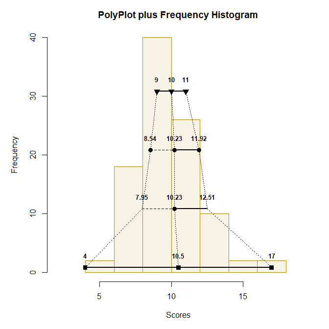

# [`polyPlot`](https://github.com/cwendorf/polyPlot/)

## A Tool for Visualizing Distributional Statistics

[](https://cran.r-project.org/)
[](https://github.com/cwendorf/polyPlot/releases/latest)
[](https://www.repostatus.org/#active)

### Overview

`polyPlot` is a small R package that offers a modified version of Seier and Bonett's (2011) polyplot, a visualization tool for various distributional summary statistics.



### Installation

This package is not currently on CRAN, but can be installed and loaded using these R commands:

``` r
if (!require(remotes)) install.packages("remotes")
remotes::install_github("cwendorf/polyPlot")
library(polyPlot)
```

If you do not wish a full install, the latest functions can be made available using this R command:

```r
source("http://raw.githubusercontent.com/cwendorf/polyPlot/main/source-polyPlot.R")
```

### Usage

This package contains a set of materials to demonstrate its use:

- [Introduction](./docs/README.md): Explanation of the basic and advanced polyPlot capabilities.
- [Exploring Data](./docs/ExploringData.md): Examples using polyPlot to explore nonnormal data.
- [PolyPlot Visualization](./docs/polyPlot.md): Documentation for the polyPlot visualization function.
- [PolyPlot Statistics](./docs/polyStats.md): Documentation for the polyStats analysis function.

### Citation

Wendorf, C.A. (2022). *polyPlot: A tool for visualizing distributional statistics* [R Package]. [https://github.com/cwendorf/polyPlot](https://github.com/cwendorf/polyPlot)
