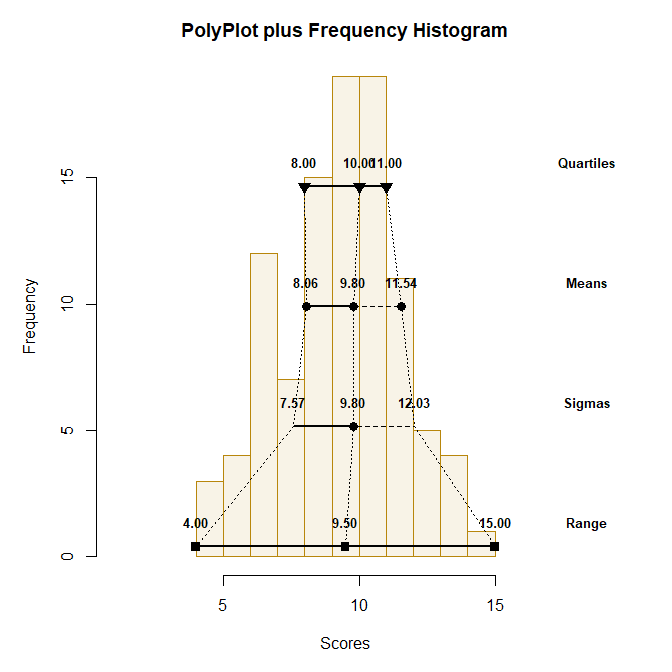

# [`polyPlot`](https://github.com/cwendorf/polyPlot/)

## Introduction

`polyPlot` is a small R package that offers a modified version of Seier and Bonett's (2011) polyplot, a visualization tool for various distributional summary statistics.

- [Overview](#overview)
- [Resources](#resources)

---

### Overview

Distribution summaries can be difficult to compare when measures of center and spread are viewed separately. `polyPlot` layers several summaries over a histogram or density curve so their relationships are visible together. Each `polyPlot` brings together quartiles, split-half means, mean-and-standard-deviation bounds, and the range. `polyStats` returns the corresponding statistics in a structured matrix.

              Lower Middle  Upper Spread
    Quartiles 8.750  10.00 11.000  1.125
    Means     8.320   9.77 11.220  1.450
    Z Scores  7.901   9.77 11.639  1.869
    Range     6.000  10.50 15.000  4.500

### Resources

- [Reference](./man/README.md): Documentation for the package functions.
- [Articles](./vignettes/README.md): Guided examples and applications of polyPlot.

### References

Seier, E., & Bonett, D. G. (2011). A Polyplot for Visualizing Location, Spread, Skewness, and Kurtosis. _The American Statistician, 65_(4), 258–261. http://www.jstor.org/stable/23339553
