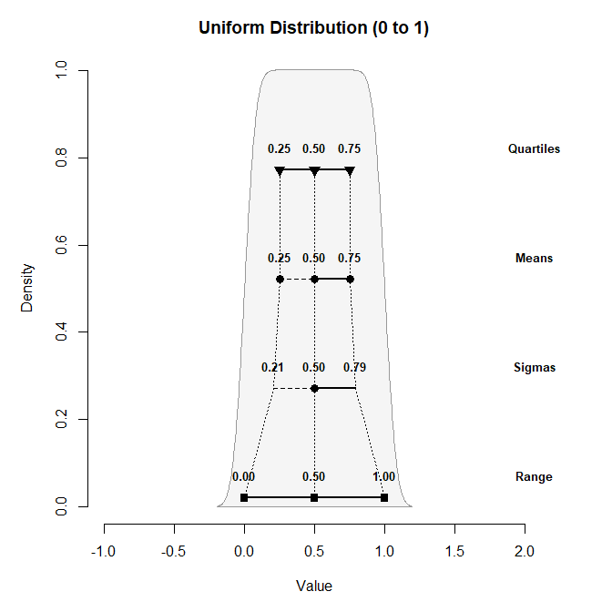
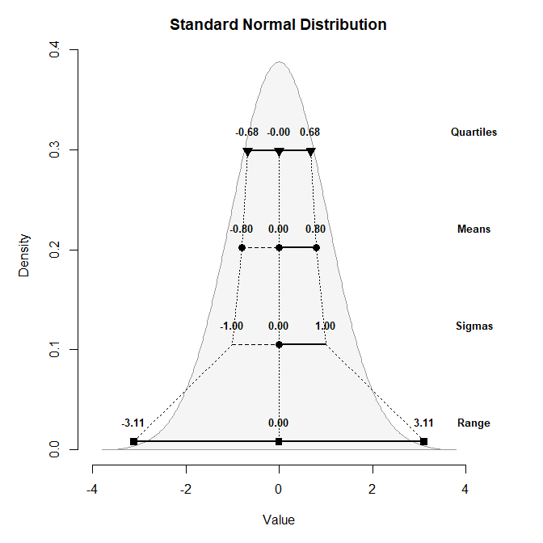
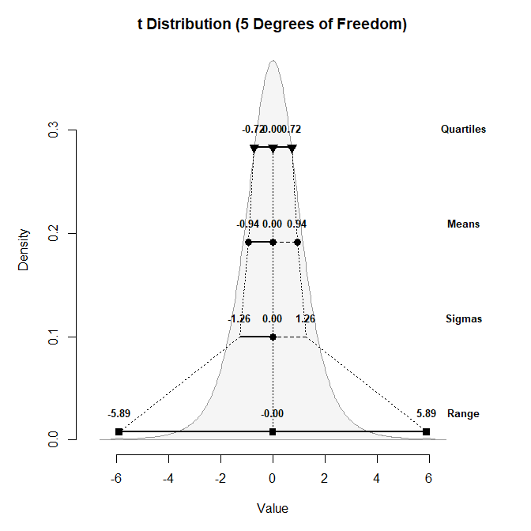
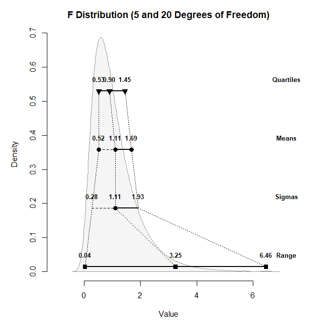
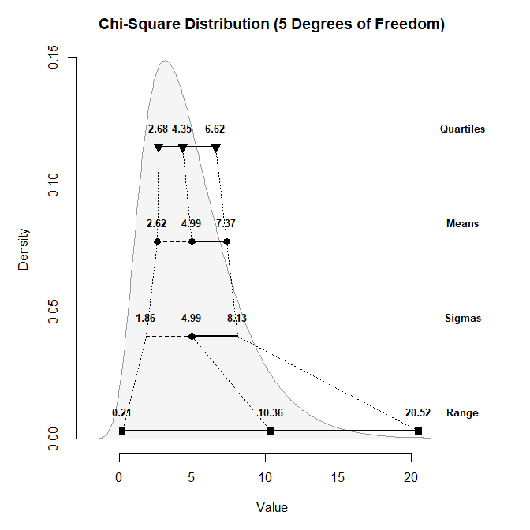

# [`polyPlot`](https://github.com/cwendorf/polyPlot/)

## polyPlot Distributions

The examples below show how the polyplot represents symmetric and skewed
distributions with different tail behavior, alongside the underlying
distribution. Histograms and density curves provide different views of
distributional shape.

- [Uniform Distribution](#uniform-distribution)
- [Standard Normal Distribution](#standard-normal-distribution)
- [t Distribution](#t-distribution)
- [F Distribution](#f-distribution)
- [Chi-Square Distribution](#chi-square-distribution)

------------------------------------------------------------------------

This vignette uses polyPlots to examine five theoretical distributions: a
uniform distribution from 0 to 1, the standard normal, a t distribution with
5 degrees of freedom, an F distribution with 5 and 20 degrees of freedom, and
a chi-square distribution with 5 degrees of freedom. To make the examples
reproducible and avoid random-sampling variation, each data vector consists
of evenly spaced quantiles from its distribution. The grid omits probabilities
below 0.001 and above 0.999, so the extreme tails are not shown in full.

``` r
probabilities <- seq(0.001, 0.999, length.out = 999)
UniformScores <- qunif(probabilities, min = 0, max = 1)
NormalScores <- qnorm(probabilities)
NormalScores <- (NormalScores - mean(NormalScores)) / sd(NormalScores)
TScores <- qt(probabilities, df = 5)
FScores <- qf(probabilities, df1 = 5, df2 = 20)
ChiSquareScores <- qchisq(probabilities, df = 5)
```

### Uniform Distribution

The uniform distribution from 0 to 1 is symmetric and bounded. Unlike the
normal distribution, it has no tails beyond its endpoints and places equal
probability across the interval.

``` r
polyPlot(
  UniformScores,
  type = "density",
  main = "Uniform Distribution (0 to 1)",
  xlab = "Value"
)
```

<!-- -->

### Standard Normal Distribution

The standard normal distribution is symmetric around zero. The normal
quantiles are centered and scaled so this finite grid has a mean of zero and
sample standard deviation of one, matching the standard normal's theoretical
location and scale. The interval one standard deviation around the mean is
therefore -1 to 1. The finite quantile grid still approximates the distribution
and omits the most extreme tails.

``` r
polyPlot(
  NormalScores,
  type = "density",
  main = "Standard Normal Distribution",
  xlab = "Value"
)
```

<!-- -->

### t Distribution

The t distribution with 5 degrees of freedom is also symmetric around zero,
but has heavier tails than the standard normal. Its mean is zero, while its
standard deviation is larger than one. The quartile and mean-based layers
show its central spread; the density background shows the broader tails.

``` r
polyPlot(
  TScores,
  type = "density",
  main = "t Distribution (5 Degrees of Freedom)",
  xlab = "Value"
)
```

<!-- -->

### F Distribution

The F distribution with 5 and 20 degrees of freedom is restricted to
nonnegative values and is right-skewed. Its mean is greater than its median,
so the mean-based layers are displaced to the right of the quartile-based
layer. The longer right tail is also reflected in the range layer and density
background.

``` r
polyPlot(
  FScores,
  type = "density",
  main = "F Distribution (5 and 20 Degrees of Freedom)",
  xlab = "Value"
)
```

<!-- -->

### Chi-Square Distribution

The chi-square distribution with 5 degrees of freedom is restricted to
nonnegative values and is right-skewed. Like the F distribution, its mean is
greater than its median; its skewness is especially pronounced near zero.

``` r
polyPlot(
  ChiSquareScores,
  type = "density",
  main = "Chi-Square Distribution (5 Degrees of Freedom)",
  xlab = "Value"
)
```

<!-- -->
