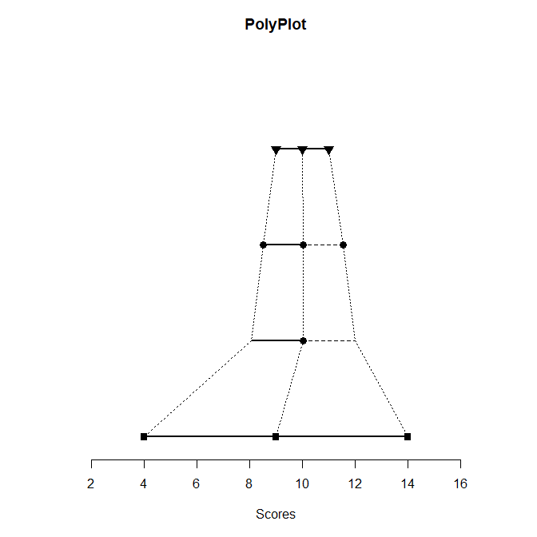
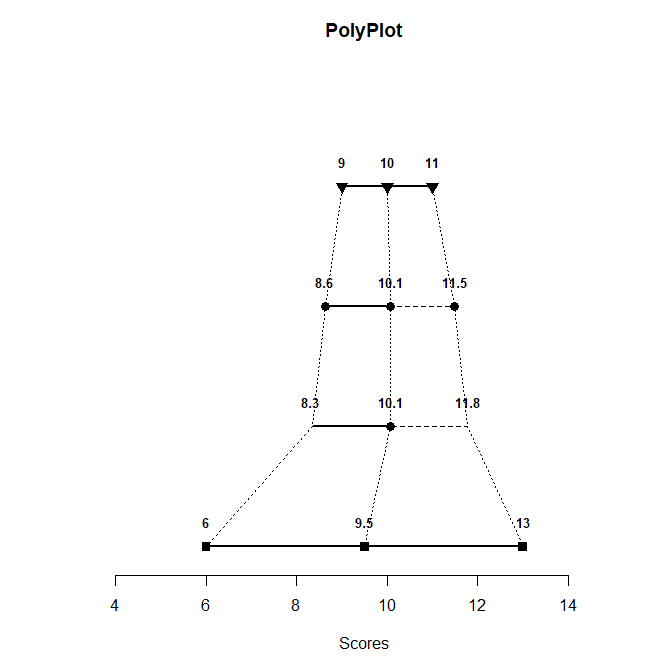
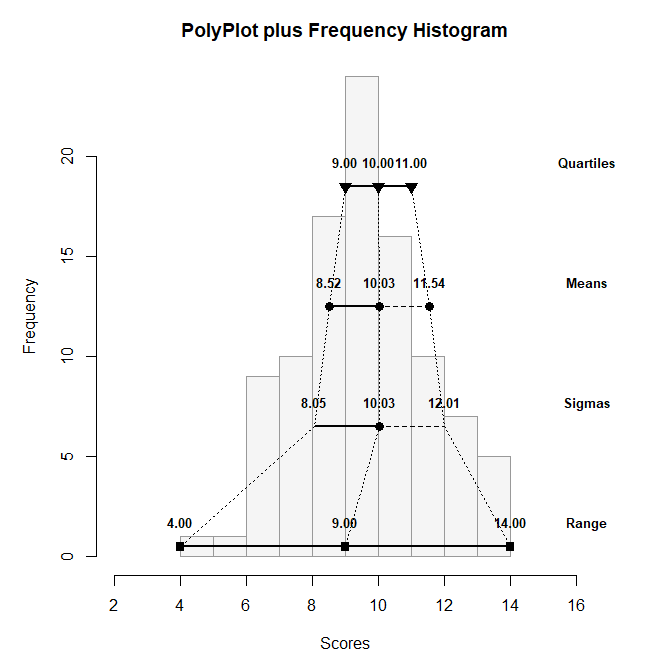
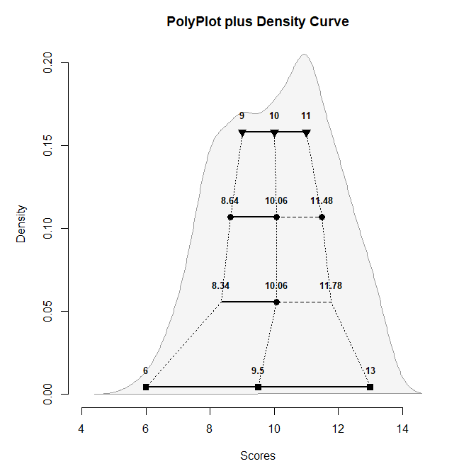
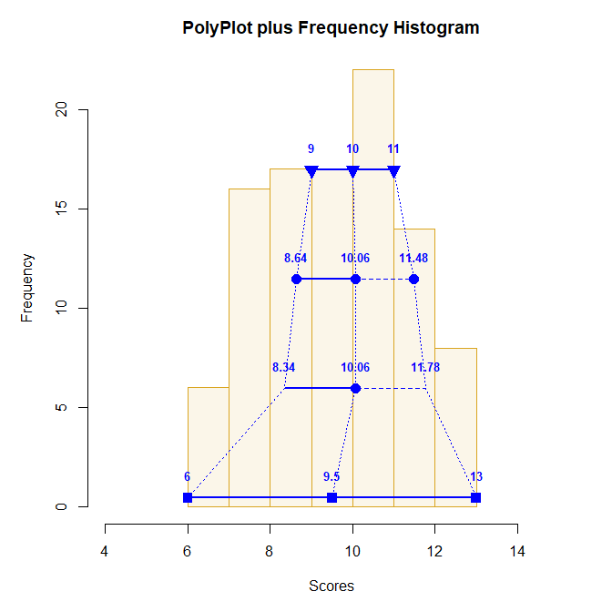
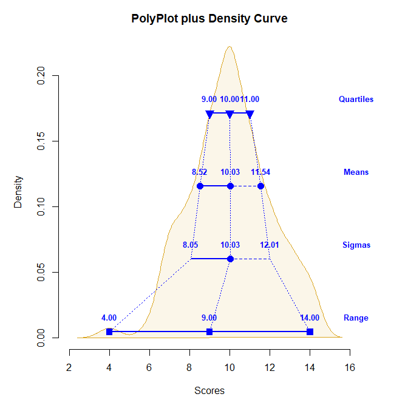
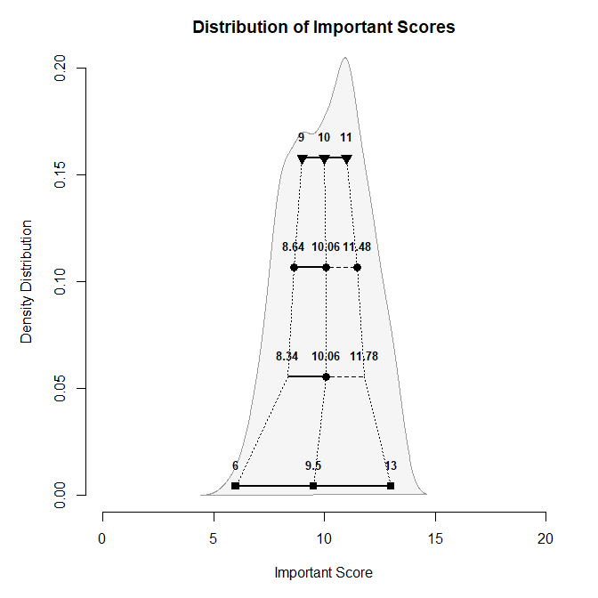

# [`polyPlot`](https://github.com/cwendorf/polyPlot/)

## polyPlot Options

`polyPlot` provides options for adding distribution context, changing
labels and limits, and adjusting the appearance of the statistical layers.

- [Value Labels](#value-labels)
- [Background Representation](#background-representation)
- [Colors and Point Size](#colors-and-point-size)
- [Titles and Axes](#titles-and-Axes)

-------------------------------------------------------------------------

The examples use a normally distributed set of scores.

``` r
Scores <- round(rnorm(100, 10, 2), 0)
```

### Value Labels

`values` controls whether the numeric values for the statistical layers
are printed on the plot. It defaults to `TRUE`. The `digits` argument
sets the number of decimal places displayed in those labels and defaults
to `2`.

``` r
polyPlot(Scores, values = FALSE)
polyPlot(Scores, values = TRUE, digits = 1)
```

<!-- -->

<!-- -->

### Background Representation

To see the relationship between the polyplot and the underlying
distribution, either a frequency distribution (histogram) or a density
curve can be added in the background.

The `type` argument controls what is shown behind the statistical layers:

- `"none"` (the default) omits a visible background distribution.
- `"frequency"` adds a frequency histogram.
- `"density"` adds a density curve.

``` r
polyPlot(Scores, type = "frequency")
polyPlot(Scores, type = "density")
```

<!-- -->

<!-- -->

### Colors and Point Size

`col` sets the color of the statistical points, lines, and value labels.
`bg` sets the background color used for the histogram or density curve.
Both default to `"black"` and `"gray60"`, respectively. The `cex`
argument scales the statistical point symbols and defaults to `1.2`.

``` r
polyPlot(Scores, type = "frequency", col = "blue", bg = "goldenrod", cex = 1.5)
polyPlot(Scores, type = "density", col = "blue", bg = "goldenrod", cex = 1.5)
```

<!-- -->

<!-- -->

### Titles and Axes

Use `main`, `xlab`, and `ylab` to set the plot title and axis labels. By
default, the title and vertical axis label depend on `type`; the
horizontal axis label is based on the input expression. `xlim` and
`ylim` accept numeric vectors of length two to set the axis limits.

``` r
polyPlot(
  Scores,
  type = "density",
  main = "Distribution of Important Scores",
  xlab = "Important Score",
  ylab = "Density Distribution",
  xlim = c(0, 20),
  ylim = c(0, 0.2)
)
```

<!-- -->
