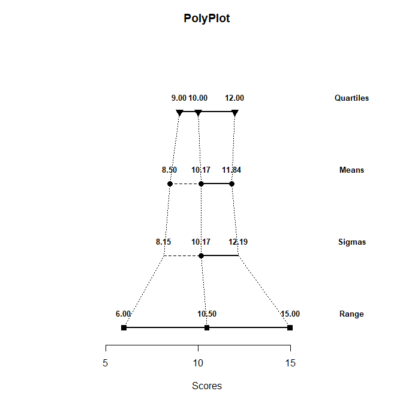
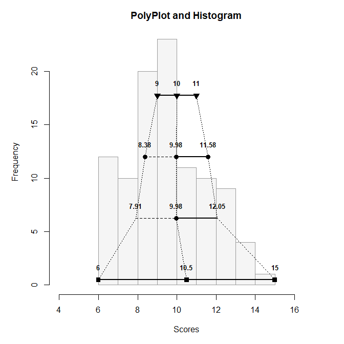
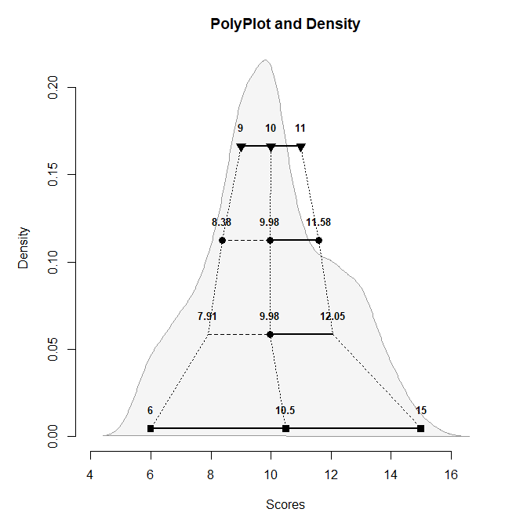

# [`polyPlot`](https://github.com/cwendorf/polyPlot/)

## PolyPlot Overview

The following code introduces the statistical layers in a standard
polyPlot and shows how a histogram or density curve can represent the
underlying distribution.

- [The Basic PolyPlot](#the-basic-polyplot)
- [Adding a Distribution](#adding-a-distribution)

------------------------------------------------------------------------

### The Basic PolyPlot

First, simulate a set of 100 scores from a normal distribution. Then
call `polyStats` to get the summary statistics and `polyPlot` to get the associated plot.

``` r
Scores <- round(rnorm(100, 10, 2), 0)
polyStats(Scores, digits = 3)
```

              Lower Middle  Upper Spread
    Quartiles 8.750  10.00 11.000  1.125
    Means     8.320   9.77 11.220  1.450
    Z Scores  7.901   9.77 11.639  1.869
    Range     6.000  10.50 15.000  4.500

``` r
polyPlot(Scores)
```

<!-- -->

### Adding a Distribution

To see the relationship between the polyplot and the underlying
distribution, either a frequency distribution (histogram) or a density
curve can be added in the background.

Use `polyPlot` to get the plot with a frequency histogram.

``` r
polyPlot(Scores, type = "frequency", main = "PolyPlot and Histogram")
```

<!-- -->

Instead, use `polyPlot` to get the plot with a density curve.

``` r
polyPlot(Scores, type = "density", main = "PolyPlot and Density")
```

<!-- -->
