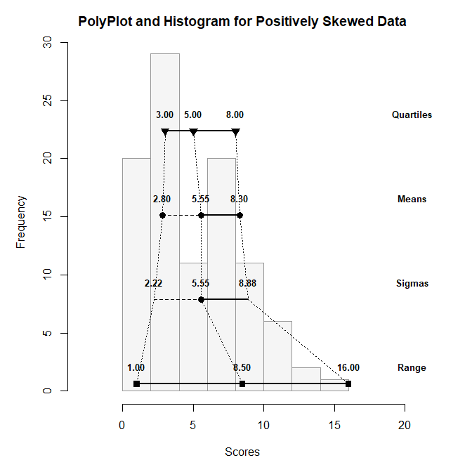
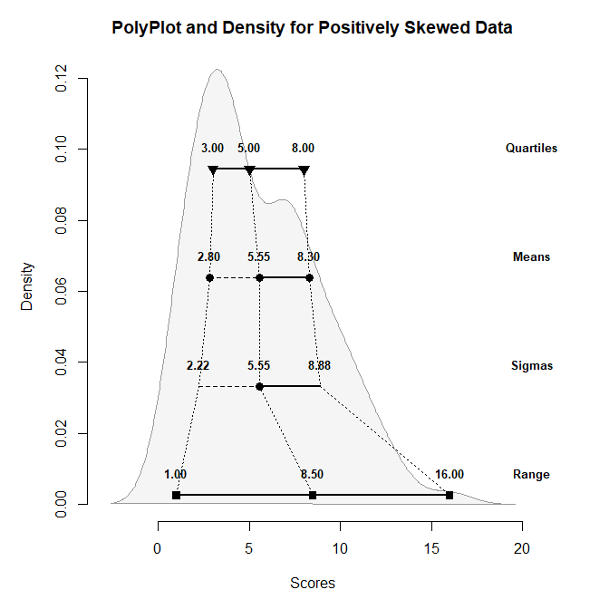
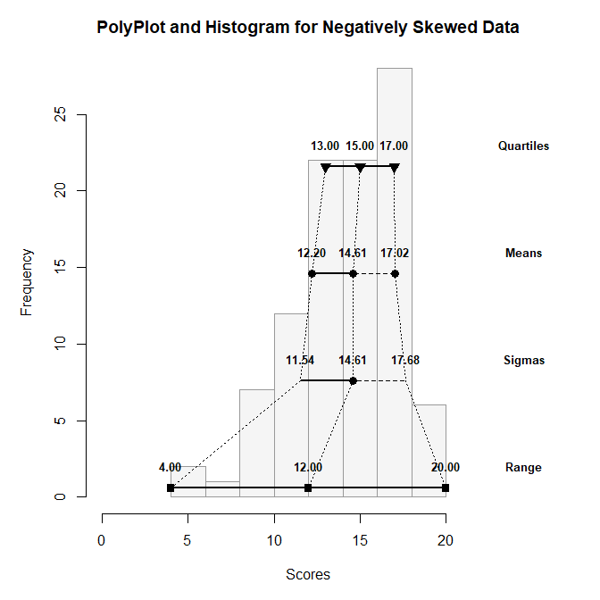
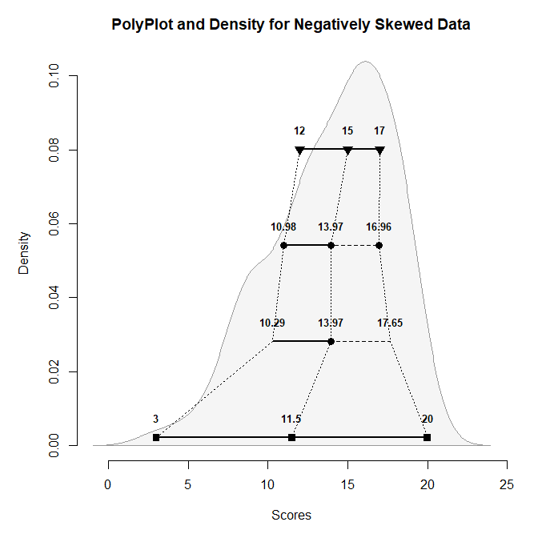
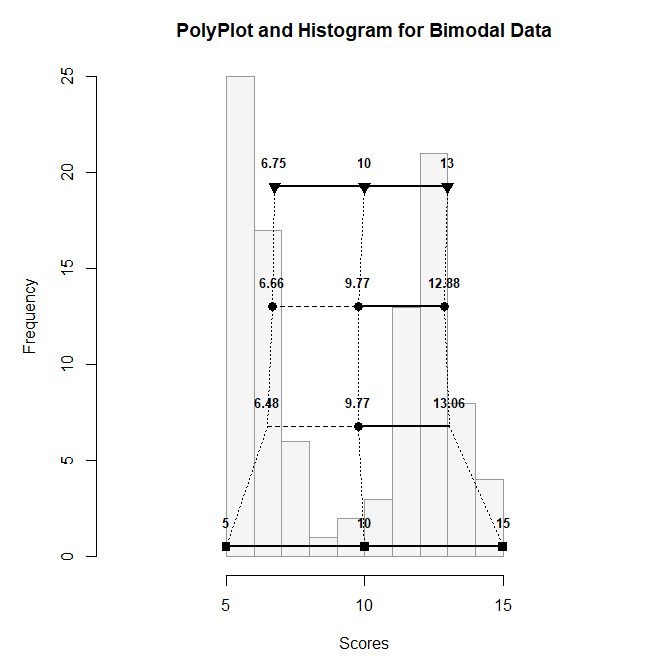
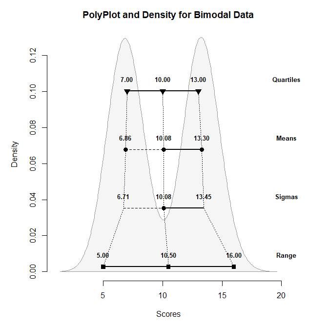

# [`polyPlot`](https://github.com/cwendorf/polyPlot/)

## polyPlot Shapes

The examples below show how the polyplot represents positive and negative skew, as well as a bimodal distribution, alongside the underlying distribution. Histograms and density curves provide different views of distributional shape.

- [Positively Skewed Data](#positively-skewed-data)
- [Negatively Skewed Data](#negatively-skewed-data)
- [Bimodal Data](#bimodal-data)

------------------------------------------------------------------------

### Positively Skewed Data

For example, simulate some positively skewed data. Use `polyPlot` to show the statistical layers with a frequency histogram and a density curve.

``` r
Scores <- round(rbeta(100, 2, 5) * 20, 0)
polyPlot(Scores, type = "frequency", main = "PolyPlot and Histogram for Positively Skewed Data")
```

<!-- -->

``` r
polyPlot(Scores, type = "density", main = "PolyPlot and Density for Positively Skewed Data")
```

<!-- -->

### Negatively Skewed Data

As another example, simulate some negatively skewed data. Use `polyPlot` to show the statistical layers with a frequency histogram and a density curve.

``` r
Scores <- round(rbeta(100, 5, 2) * 20, 0)
polyPlot(Scores, type = "frequency", main = "PolyPlot and Histogram for Negatively Skewed Data")
```

<!-- -->

``` r
polyPlot(Scores, type = "density", main = "PolyPlot and Density for Negatively Skewed Data")
```

<!-- -->

### Bimodal Data

As a final example, simulate some bimodal data. The histogram and
density curve each provide a view of its two peaks.

``` r
Scores <- c(round(rnorm(50, 7, 1), 0), round(rnorm(50, 13, 1), 0))
polyPlot(Scores, type = "frequency", main = "PolyPlot and Histogram for Bimodal Data")
```

<!-- -->

``` r
polyPlot(Scores, type = "density", main = "PolyPlot and Density for Bimodal Data")
```

<!-- -->
